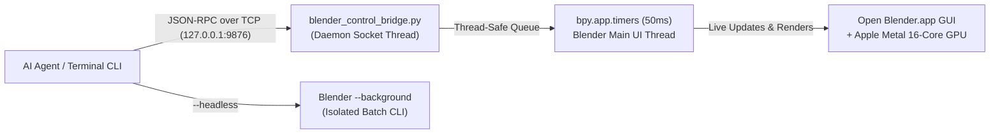
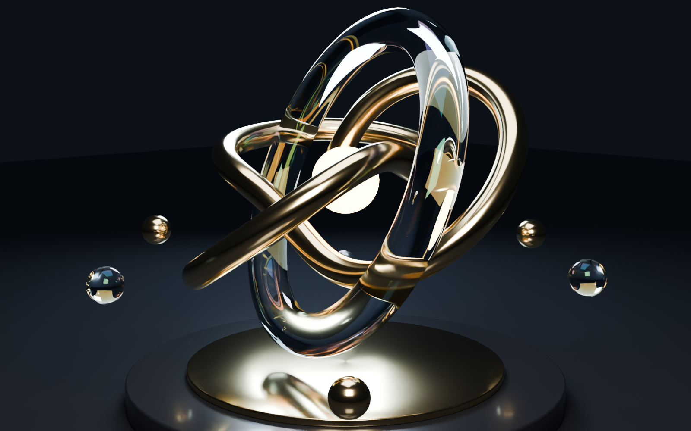
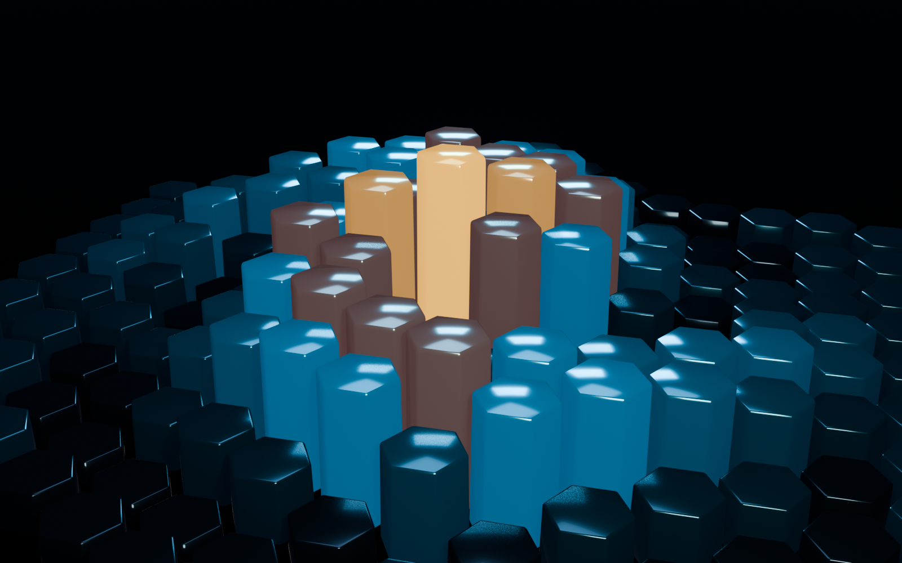
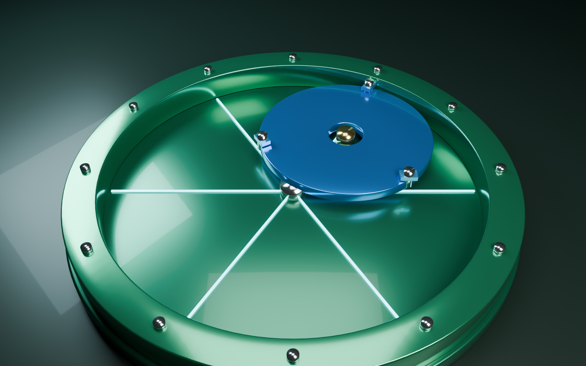

# Blender Control (`BLENDER_CONTROL`)

Live GUI & headless CLI control system for **Blender 5.2 LTS** on macOS (Apple Silicon Metal GPU), packaged as an **Antigravity Workspace Skill** ([`.agents/skills/blender-control/SKILL.md`](./.agents/skills/blender-control/SKILL.md)).

## Architecture



## Key Features

- **Zero-Lag Live GUI Control**: `blender_control_bridge.py` runs inside `Blender.app` (`~/Library/Application Support/Blender/5.2/scripts/startup/`) and executes Python/`bpy` scripts safely on Blender's main UI thread every `50ms`, updating the 3D Viewport in real time.
- **Full CLI Client (`blender_cli.py`)**: `ping`, `info`, `reset`, `exec`, `run`, `viewport`, `screenshot`, `render`, `render-anim`, `save`, and `open` — plus `--headless` batch mode.
- **Blender 5.2 LTS & Apple Silicon Ready**: Automatic **Metal GPU** configuration for Cycles, `AgX` color management, Slotted Action `channelbag` keyframe helpers, and `MPEG4`/`H.264` animation export.
- **Continuous GitHub Sync**: Includes [`scripts/sync_github.sh`](./scripts/sync_github.sh) and workspace rules in [`AGENTS.md`](./AGENTS.md) to keep local and remote `origin/main` synchronized.

## Quick Start

```bash
# 1. Install startup bridge & connect to open Blender.app
bash .agents/skills/blender-control/scripts/install_bridge.sh

# 2. Check live Blender status & scene objects
python3 .agents/skills/blender-control/scripts/blender_cli.py ping
python3 .agents/skills/blender-control/scripts/blender_cli.py info

# 3. Build a scene live in the open Blender window & switch viewport to Material Camera view
python3 .agents/skills/blender-control/scripts/blender_cli.py run projects/03_straight_line_mechanism/build.py
python3 .agents/skills/blender-control/scripts/blender_cli.py viewport --shading MATERIAL

# 4. Render a high-res Cycles Metal GPU image or H.264 MP4 animation
python3 .agents/skills/blender-control/scripts/blender_cli.py render projects/01_glass_metal_sculpture/render.png --engine CYCLES --samples 64
python3 .agents/skills/blender-control/scripts/blender_cli.py render-anim projects/03_straight_line_mechanism/animation.mp4 --engine BLENDER_EEVEE
```

---

## Showcase Test Projects

### 1. Architectural Glass & Brushed Gold Torus-Knot Sculpture (`projects/01_glass_metal_sculpture/`)
- **Engine**: Cycles (Apple M1 Pro 16-core Metal GPU, 64 samples + OptiX/OpenImageDenoise, `AgX - Medium High Contrast`)
- **Highlights**: Parametric `(2,3)` NURBS torus knot in anisotropic champagne gold interlocked with a thin-film dispersion crystal glass torus, luminous core, studio 3-point area lighting, and `75mm` Depth-of-Field camera.



### 2. Parametric Hexagonal Harmonic Wave Matrix (`projects/02_parametric_cyber_grid/`)
- **Engine**: Blender EEVEE (`1600x1000`, 64 TAA samples, `AgX`)
- **Highlights**: `169` procedural `bmesh` beveled hexagonal prisms modulated by a radial spiral interference wave across 8 metallic/emissive material tiers.



### 3. Tusi Couple / Cardano Straight-Line Mechanism (`projects/03_straight_line_mechanism/`)
- **Engine**: Blender EEVEE (`1280x720` @ `30 FPS`, `120` seamless loop frames, `H.264` MP4 + `1600x1000` Cycles Metal GPU still)
- **Highlights**: Exact hypocycloid kinematics (`R_outer = 2 * R_inner`) converting continuous circular crank & planetary gear rotation into **three intersecting, non-colliding straight-line shuttle motions** (`0°`, `60°`, `120°`) inside an anodized emerald-green stator housing.



- **Animation Video**: [`projects/03_straight_line_mechanism/animation.mp4`](./projects/03_straight_line_mechanism/animation.mp4)

---

## Repository Structure

```text
.
├── .agents/skills/blender-control/
│   ├── SKILL.md                           # Main Antigravity skill instructions
│   ├── references/
│   │   └── blender_5_2_api_guide.md       # Blender 5.2 LTS Python 3.13 API reference
│   └── scripts/
│       ├── blender_cli.py                 # TCP JSON-RPC client & headless runner
│       ├── blender_control_bridge.py      # Blender main-thread startup server (127.0.0.1:9876)
│       └── install_bridge.sh              # Bridge installer & live GUI connector
├── projects/
│   ├── 01_glass_metal_sculpture/          # Cycles Metal GPU glass & gold sculpture
│   ├── 02_parametric_cyber_grid/          # Procedural bmesh hexagonal wave matrix
│   └── 03_straight_line_mechanism/        # Animated hypocycloid straight-line mechanism
├── scripts/
│   └── sync_github.sh                     # One-command pull/commit/push GitHub sync
└── AGENTS.md                              # Always-on workspace rules
```
